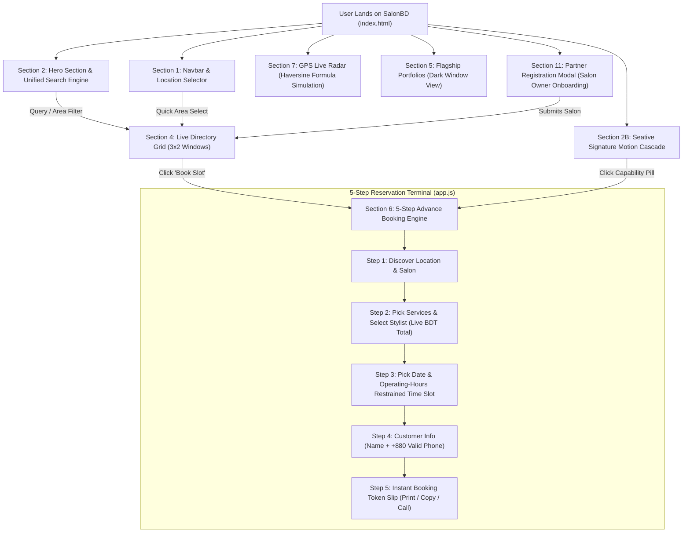

# System Architecture & Technical Specifications
## Project: SalonBD (সেলুন ডিরেক্টরি ও অ্যাডভান্স বুকিং প্ল্যাটফর্ম)

---

### ১. সিস্টেম আর্কিটেকচার ও ডেটা ফ্লো (System Architecture & Data Flow)



---

### ২. ফোল্ডার ও ফাইল স্ট্রাকচার (Folder & File Structure)

```
selon/
│
├── index.html            # মূল সিঙ্গেল-পেজ মার্কআপ (১১টি সুনির্দিষ্ট সেকশন ও মোডাল সহ)
├── styles.css            # সুইচ গ্রিড, উইন্ডো আর্কিটেকচার, ৩ডি পারস্পেক্টিভ ও কাস্টম সিএসএস
├── app.js                # বিএসটি লাইভ ক্যালকুলেটর, বুকিং ইঞ্জিন স্টেট, এরিয়া ফিল্টার ও জিপিএস লজিক
│
├── Prd.md                # প্রডাক্ট রিকোয়ারমেন্টস ও ফিচার স্পেসিফিকেশন
├── Architecture.md       # সিস্টেম আর্কিটেকচার, ডেটা ফ্লো ও ফাইল স্ট্রাকচার (This File)
├── Rules.md              # কোডিং ও ডিজাইন রুলস, করণীয় ও বর্জনীয় নীতিমালা
├── Phases.md             # প্রোডাক্ট রিলিজ ফেজ ও সেকশন-ভিত্তিক রোডম্যাপ
├── Design.md             # ডিজাইন টোকেন, কালার প্যালেট, টাইপোগ্রাফি ও ইউআই/ইউএক্স গাইড
└── Memory.md             # প্রজেক্ট ব্রেন, সিদ্ধান্ত হিস্ট্রি ও নতুন ডেভেলপারের অনবোর্ডিং গাইড
```

---

### ৩. ফাইলগুলোর দায়িত্ব ও কারিগরি বিবরণ (File Responsibilities)

1. [**`index.html`**](file:///e:/work%20station/selon/index.html):
   - সিম্যান্টিক HTML5 পেজ স্ট্রাকচার।
   - লাইট (`#FAFAFA`) ও ডার্ক (`#0F0F11`) সেকশনের ছন্দবদ্ধ বিন্যাস।
   - টগলযোগ্য দ্বিভাষিক ডাটা অ্যাট্রিবিউট (`data-i18n`) যুক্ত।
   - প্রিন্টেবল বুকিং টোকেন কন্টেইনার (`#printable-token-card`)।

2. [**`styles.css`**](file:///e:/work%20station/selon/styles.css):
   - CSS ভ্যারিয়েবল ও ডিজাইন টোকেন (`:root` ভ্যারিয়েবলস)।
   - উইন্ডো ও বেন্টো কার্ড ইউআই ফ্রেমওয়ার্ক (`.window-card`, `.mini-window-card`)।
   - ৩ডি কার্ড ক্যাসকেড অ্যানিমেশন (`.cascade-stage`, `.cascade-card.state-active`)।
   - প্রিন্ট স্টাইলশীট (`@media print`) বুকিং টোকেন প্রিন্ট করার জন্য।

3. [**`app.js`**](file:///e:/work%20station/selon/app.js):
   - **`SALON_DATABASE`**: বাংলাদেশের বাস্তবসম্মত সেলুন তথ্য, জিপিএস কোঅর্ডিনেট ও রেট কার্ডের অ্যারে।
   - **BST Live Engine**: `getBSTDate()` এবং `calculateSalonStatus()` যা প্রতি মিনিটে সময় হিসাব করে।
   - **Dynamic Slot Generator**: সেলুন খোলার এবং বন্ধের সময়ের মধ্যে ৩০ মিনিট অন্তর স্লট তৈরি।
   - **Proximity Radar Engine**: `calculateHaversineDistance()` ব্যবহার করে ২ কিমি ব্যাসার্ধের দূরত্ব হিসাব।
   - **Toast Notification Dispatcher**: ব্যবহারকারীর ইন্টারঅ্যাকশনে নন-ব্লকিং টোস্ট মেসেজ প্রদর্শন।

---

### ৪. রানটাইম ও প্রযুক্তি স্ট্যাক (Technology Stack)

- **Frontend Core:** HTML5, CSS3, Vanilla JavaScript (ES6+ modular).
- **CSS Utility:** Tailwind CSS (via CDN) + Bespoke Custom Styles (`styles.css`).
- **Web Fonts:** Plus Jakarta Sans (ইংরেজি), Hind Siliguri (বাংলা), JetBrains Mono (ডাটা ও কোড)।
- **Architecture Pattern:** Window/Bento UI + Editorial Swiss Grid + State-Driven Dynamic DOM Rendering.
- **Portability:** জিরো এক্সটার্নাল ডিপেন্ডেন্সি; যেকোনো স্ট্যাটিক ফাইল হোস্টিং (Vercel, Netlify, GitHub Pages, Cloudflare Pages) এ এক ক্লিকে ডিপ্লয়যোগ্য।

