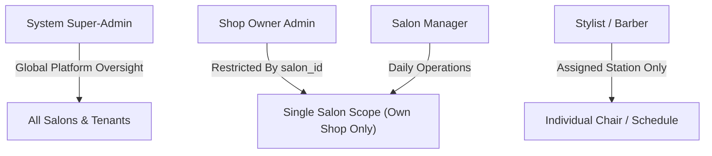
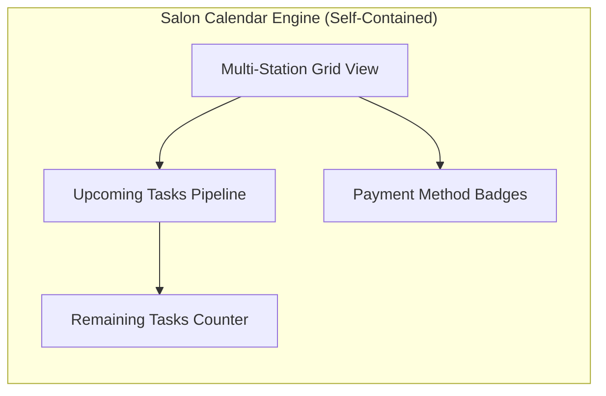
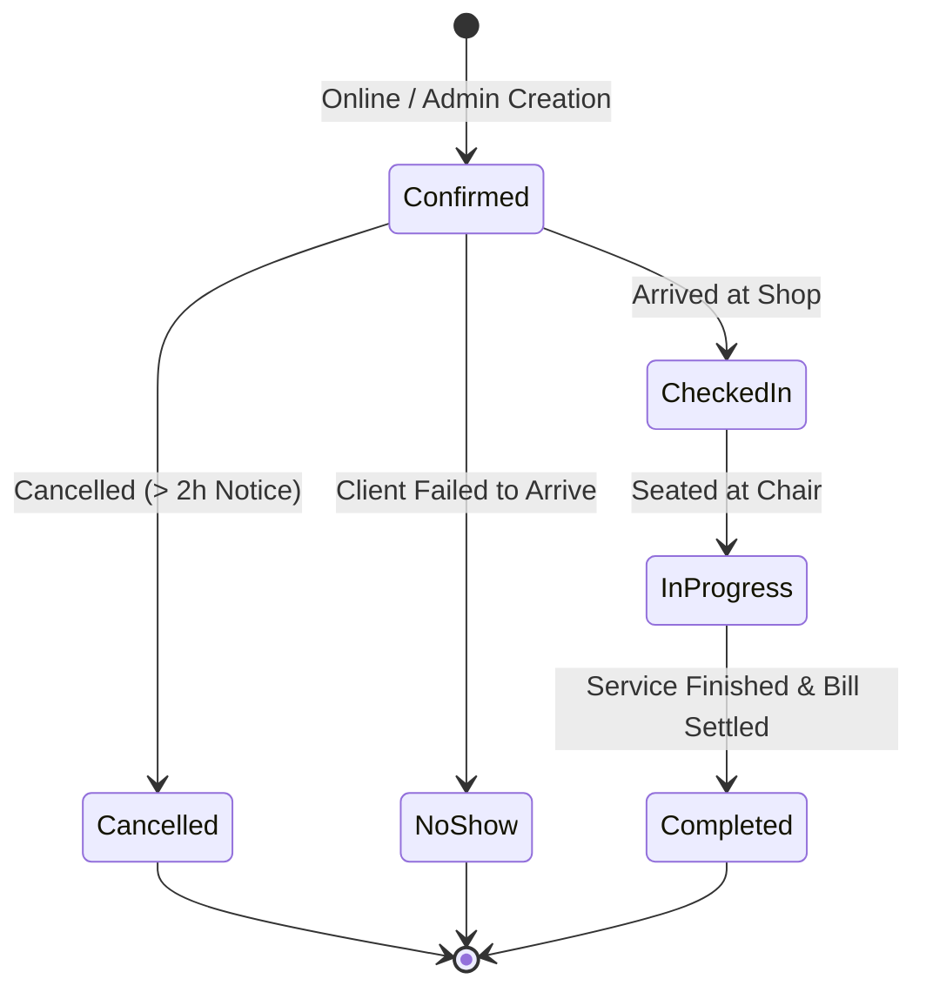
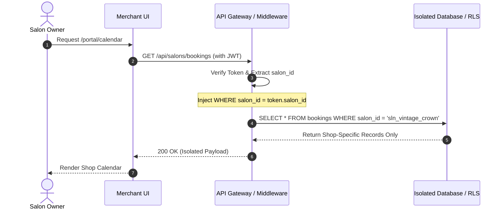
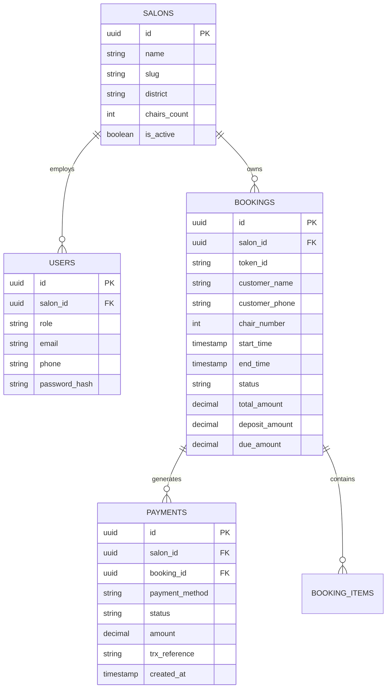

# Salon-Specific Calendar and Admin Access System Requirements

**Document Version:** 1.0.0  
**Status:** Approved Architectural Specification  
**Architecture Domain:** Multi-Tenant Salon Operating System & Merchant Portal  

---

## 1. Overview

The **Salon-Specific Calendar and Admin Access System** provides a multi-tenant operational control center designed for a distributed network of independent salons. While salons operate within a shared physical network and digital marketplace, each salon tenant acts as an isolated operational silo.

### 1.1 Core Business Objectives
- **Strict Data Isolation:** Guarantee absolute tenant tenancy boundaries so that salon owners and staff can only access, view, and manipulate bookings, calendar tasks, and financial summaries originating within their assigned shop.
- **Dedicated Independent Calendar Engine:** Provide each salon with a fully self-contained calendar interface displaying real-time chair schedules, assigned stylists, customer reservation details, and payment method indicators.
- **Shop-Scoped Administration:** Equip salon owners with a dedicated dashboard to triage daily appointments, manage upcoming chair commitments, track remaining workloads, and enforce operational capacity without leaking cross-tenant data.
- **Payment Method & Status Transparency:** Capture and display payment methods (bKash, Nagad, POS Card, Cash at Chair, Bank Transfer) and verification statuses without exposing sensitive payment account details to the UI.

---

## 2. User Roles & Permissions

The system implements strict Role-Based Access Control (RBAC) enforced at both the API routing layer and the database layer (via PostgreSQL Row-Level Security / query-level tenancy filters).



### 2.1 Role Definitions

| Role | Scope | Key Permissions | Explicit Constraints |
| :--- | :--- | :--- | :--- |
| **System Super-Admin** | Global Platform | • Onboard/Decommission salons<br>• Provision Shop Owner accounts<br>• Platform-wide audit log inspection<br>• Global system telemetry & metrics | Cannot impersonate a salon to modify customer bookings without audit logging. |
| **Shop Owner Admin** | Tenant (`salon_id`) | • Full access to shop calendar & booking lifecycle<br>• Manage shop staff (managers, stylists)<br>• View payment method & settlement status<br>• Configure rate cards, opening hours, chair counts | **Strictly blocked** from reading, querying, or editing records belonging to another salon. |
| **Salon Manager / Receptionist** | Tenant (`salon_id`) | • View and edit daily calendar schedules<br>• Check in arriving clients, reassign chairs<br>• Collect balance due at chair and mark complete<br>• Trigger no-show deposits forfeiture | Cannot alter shop financial configuration or delete salon records. |
| **Stylist / Barber** | Station (`barber_id`) | • View personal daily appointment queue<br>• Mark assigned service as started/completed | Cannot view shop revenue rollups or modify other stylists' schedules. |

### 2.2 Permission Matrix

| Action / Entity | System Super-Admin | Shop Owner Admin | Salon Manager | Stylist |
| :--- | :---: | :---: | :---: | :---: |
| **View Shop Calendar** | Global (All) | Own Shop Only | Own Shop Only | Own Assigned Slots |
| **Create / Reschedule Booking** | Yes | Yes (Own Shop) | Yes (Own Shop) | No |
| **Cancel Booking** | Yes | Yes (Own Shop) | Yes (Own Shop) | No |
| **Mark No-Show / Forfeit Deposit** | Yes | Yes (Own Shop) | Yes (Own Shop) | No |
| **View Payment Method & Status** | Global | Yes (Own Shop) | Yes (Own Shop) | Service Name Only |
| **Access Sensitive Payment Details** | **Never Exposed** | **Never Exposed** | **Never Exposed** | **Never Exposed** |
| **Manage Shop Staff & Hours** | Yes | Yes (Own Shop) | Read-only | Read-only |

---

## 3. Calendar Features

The calendar engine is completely self-contained (zero dependency on external third-party calendar clouds like Google Calendar or Outlook) and tailored specifically for salon chair scheduling.



### 3.1 Per-Salon View
- **Multi-Station Day Grid:** Displays columns corresponding to active barber chairs/stations within the authenticated salon (e.g., Chair 1 to Chair N). Rows represent time blocks in 15-minute, 30-minute, or 60-minute increments according to the shop's configured operating hours.
- **Multi-View Modes:**
  - **Day View:** High-density chair breakdown showing active client in chair, stylist name, service requested, and real-time status.
  - **Week View:** Aggregated appointment volume per station across Monday–Sunday.
  - **Agenda / List View:** Chronological triage list of all appointments scheduled for the day.
- **Booking Card Metadata:**
  - Customer Full Name and Contact Badge (phone masked according to privacy policy).
  - Service item, scheduled start time, estimated duration, and end time.
  - Stylist / Barber assigned.
  - **Payment Indicator:** Discrete badge indicating payment method (e.g., `bKash Deposit ৳50`, `Bank Transfer`, `Due at Chair ৳450`) and payment status (`Verified`, `Deposit Paid`, `Unpaid`).

### 3.2 Upcoming Tasks & Schedule Pipeline
- **Real-Time Task Stream:** Automatically groups upcoming commitments by status:
  - `Upcoming`: Confirmed bookings arriving within the next 2 to 24 hours.
  - `Arrived / Checked-In`: Client present in waiting lounge, awaiting chair allocation.
  - `In-Chair`: Active cutting/styling in progress with elapsed time counter.
- **Next Day Horizon:** A collapsible panel displaying tomorrow's confirmed appointments, highlighting VIP clients or high-duration chemical/coloring treatments.

### 3.3 Remaining Tasks Count
- **Dynamic Task Counter Header:** A live counter embedded in the calendar action bar:
  $$\text{Remaining Tasks Today} = \text{Total Confirmed Bookings} - (\text{Completed} + \text{Cancelled} + \text{No-Show})$$
- Visual progress bar showing percentage of daily bookings fulfilled (e.g., `14/22 Completed • 8 Remaining Today`).

---

## 4. Booking Management

The system governs the lifecycle of every appointment from initiation through chair completion or cancellation.



### 4.1 Booking Lifecycle Stages
1. **Creation:**
   - **Customer Channel:** Created via dedicated salon storefront or public marketplace with advance token deposit.
   - **Admin Walk-In / Phone Creation:** Shop owner or receptionist can manually reserve an open chair slot via an "Add Booking" quick modal. Automatically tags source as `walk_in` or `phone_reservation`.
   - **Validation Rules:** System strictly prohibits double-booking the same chair or barber during overlapping time windows.
2. **Viewing:**
   - Detailed inspection drawer displays appointment token ID (e.g., `SLN-DHA-4819`), customer name, requested services, assigned station, notes, and deposit audit log.
3. **Editing & Rescheduling:**
   - Salon owners can drag-and-drop or modify the start time, swap assigned barber/chair, or add add-on services (e.g., Beard Trim added to Haircut).
   - If time changes, the system recalculates slot availability and sends an automated SMS notification to the customer.
4. **Cancellation & No-Show Handling:**
   - **Standard Cancellation:** Permitted with advance notice; releases the chair slot back to available inventory.
   - **No-Show Forfeiture:** If client fails to appear within 20 minutes past reservation time, the admin triggers `Mark No-Show`. The chair is released, and the advance deposit is forfeited and credited to the salon's compensation ledger.

---

## 5. Payment Tracking

To comply with business constraints, raw financial credentials (such as customer credit card PANs, banking PINs, or internal bank account numbers) are **never** stored or rendered in the admin interface.

### 5.1 Payment Method Capture
The system categorizes and tracks the authorized method used for each transaction:
- `bkash_mfs`: Mobile Financial Service (bKash) token or deposit.
- `nagad_mfs`: Mobile Financial Service (Nagad) token or deposit.
- `bank_transfer`: Electronic Funds Transfer / Wire.
- `pos_card`: Physical POS terminal swipe at the salon desk.
- `cash_desk`: Physical cash collected at the chair counter.

### 5.2 Payment Status Progression
- `deposit_paid`: Mandatory advance token (e.g., ৳50 / ৳100) received and verified. Balance remaining due at chair.
- `fully_paid`: Complete bill amount settled.
- `due_at_salon`: Advance unpaid or walk-in reservation; full amount due upon arrival.
- `refunded`: Deposit returned due to salon-initiated cancellation.
- `forfeited_noshow`: Deposit claimed by salon following verified customer no-show.

### 5.3 Financial Audit Trail
Every payment event generates an immutable log entry containing:
- Timestamp (Asia/Dhaka BST).
- Transaction Reference ID (MFS TrxID or internal POS reference).
- Actor ID (Customer via PGW / Receptionist / Super-Admin).
- Action code (`DEPOSIT_CAPTURED`, `BALANCE_COLLECTED`, `NO_SHOW_FORFEITED`).
- Net amount collected, platform fee deducted, and salon payout allocation.

---

## 6. Access Control & Security

### 6.1 Authentication & Login Flow
- **Authentication Surface:** Independent login route (`/portal/login` or unified modal with role-based redirection).
- **Credentials:** Shop Owner email/phone + cryptographically salted bcrypt/Argon2 password hash, reinforced by SMS OTP verification for multi-factor security.
- **Tenant Resolution:** Upon successful authentication, the system retrieves the user's bound `salon_id` and mints an encrypted JSON Web Token (JWT) or secure HTTP-only session cookie containing:
  ```json
  {
    "sub": "usr_99182371",
    "role": "shop_owner_admin",
    "salon_id": "sln_vintage_crown",
    "salon_slug": "vintage-crown",
    "iat": 1730128000,
    "exp": 1730171200
  }
  ```

### 6.2 Shop-Scoped Session Enforcement


### 6.3 Security Guarantees
- **No Cross-Tenant Leaks:** Even if an owner attempts to manipulate request parameters (e.g., `GET /api/bookings?salon_id=other_salon`), the backend middleware overrides the query parameter with the cryptographically verified `salon_id` from the session token.
- **Zero Raw Payment Data Exposure:** Admin UI components only receive sanitized payment descriptors: `method: "bkash"`, `status: "deposit_paid"`, `amount: 50.00`, `trx_id_masked: "TRX-***-8491"`.

---

## 7. Data Model

The data layer is structured to enforce foreign key constraints, tenant indexing, and row-level separation.



### 7.1 Table: `salons`
Represents independent merchant entities.
- `id` (UUID, Primary Key, Default: `gen_random_uuid()`)
- `name` (VARCHAR(150), Not Null)
- `slug` (VARCHAR(100), Unique, Not Null) — used for storefront URL
- `district` (VARCHAR(50), Not Null)
- `address` (TEXT, Not Null)
- `chairs_count` (INTEGER, Default: 4)
- `opening_time` (TIME, Default: `'09:00'`)
- `closing_time` (TIME, Default: `'22:00'`)
- `created_at` (TIMESTAMPTZ, Default: `NOW()`)

### 7.2 Table: `users`
Accounts authorized to manage the platform and individual salons.
- `id` (UUID, Primary Key, Default: `gen_random_uuid()`)
- `salon_id` (UUID, Nullable, Foreign Key → `salons.id`) — Null for Super-Admins, mandatory for Shop Owners.
- `role` (VARCHAR(30), Not Null) — `'super_admin'`, `'shop_owner_admin'`, `'manager'`, `'stylist'`
- `full_name` (VARCHAR(100), Not Null)
- `email` (VARCHAR(120), Unique, Not Null)
- `phone` (VARCHAR(20), Not Null)
- `password_hash` (TEXT, Not Null)
- `is_active` (BOOLEAN, Default: `true`)

### 7.3 Table: `bookings`
Individual appointment records isolated by `salon_id`.
- `id` (UUID, Primary Key, Default: `gen_random_uuid()`)
- `salon_id` (UUID, Not Null, Foreign Key → `salons.id`, Index)
- `token_id` (VARCHAR(20), Unique, Not Null) — Public identifier (e.g. `SLN-DHA-9412`)
- `customer_name` (VARCHAR(100), Not Null)
- `customer_phone` (VARCHAR(20), Not Null)
- `chair_number` (INTEGER, Not Null)
- `barber_name` (VARCHAR(100), Not Null)
- `service_summary` (VARCHAR(255), Not Null)
- `start_time` (TIMESTAMPTZ, Not Null, Index)
- `end_time` (TIMESTAMPTZ, Not Null)
- `status` (VARCHAR(30), Default: `'confirmed'`) — `'confirmed'`, `'checked_in'`, `'in_chair'`, `'completed'`, `'cancelled'`, `'no_show'`
- `gross_total` (DECIMAL(10,2), Not Null)
- `deposit_paid` (DECIMAL(10,2), Default: `0.00`)
- `balance_due` (DECIMAL(10,2), Not Null)

### 7.4 Table: `payments`
Financial tracking and audit ledger per booking.
- `id` (UUID, Primary Key, Default: `gen_random_uuid()`)
- `salon_id` (UUID, Not Null, Foreign Key → `salons.id`, Index)
- `booking_id` (UUID, Not Null, Foreign Key → `bookings.id`, Index)
- `payment_method` (VARCHAR(30), Not Null) — `'bkash_mfs'`, `'nagad_mfs'`, `'bank_transfer'`, `'pos_card'`, `'cash_desk'`
- `payment_type` (VARCHAR(30), Not Null) — `'deposit'`, `'full_settlement'`, `'no_show_forfeit'`
- `status` (VARCHAR(30), Not Null) — `'verified'`, `'pending'`, `'settled'`, `'forfeited'`, `'refunded'`
- `amount` (DECIMAL(10,2), Not Null)
- `trx_reference` (VARCHAR(100), Nullable)
- `created_at` (TIMESTAMPTZ, Default: `NOW()`)

---

## 8. UI Mock-Up Descriptions

### 8.1 Admin Dashboard Layout (`[FILL: example of a salon admin dashboard layout]`)
- **Top Navigation Bar:**
  - Left: Salon brand monogram badge, shop name (e.g., `Vintage Crown Barbershop`), and live BST digital clock (`15:30:00 BST`).
  - Right: Quick Action (`+ Walk-in Booking`), Notification bell for new online reservations, Shop status pill (`● Studio Open`), and User Profile dropdown.
- **Top Metric Pulse Cards (4-Column Bento):**
  1. *Today's Appointments:* Count with progress bar (e.g., `18 Total • 12 Done • 6 Remaining`).
  2. *Active Chairs in Service:* Ratio of occupied stations (e.g., `4 / 5 Chairs Busy`).
  3. *Deposits Collected Today:* Total advance tokens secured via bKash/Nagad (e.g., `৳ 900`).
  4. *Pending Due at Chair:* Outstanding balances awaiting completion (e.g., `৳ 7,450`).
- **Main Operational Area:**
  - Tab 1: **Interactive Chair Calendar & Scheduler** (Default view).
  - Tab 2: **Live Queue & Check-In Radar** (Real-time client arrival list).
  - Tab 3: **Remaining Daily Tasks & Pipeline** (Checklist of upcoming cuts, treatments, and closures).
  - Tab 4: **Rate Card & Service Pricing Catalog**.
  - Tab 5: **Staff Roster & Chair Assignments**.

### 8.2 Calendar Station Grid View
- **Controls Header:** Date navigation (`< Today >`), View selector (`Day Stations`, `Weekly`, `Agenda`), Filter by Stylist (`All Barbers` or specific name), and Search bar.
- **Station Grid Columns:**
  - One vertical column per chair (Station 1, Station 2, Station 3...).
  - Time indicator bar spanning shop operating hours (09:00 to 22:00) with a live red horizontal line tracking the current minute.
- **Appointment Block Visual Elements:**
  - Rounded luxury card styled with subtle elevation and color-coded status border:
    - *Blue:* Confirmed / Upcoming.
    - *Amber:* Checked-in (Arrived in lobby).
    - *Emerald:* In-Chair (Cutting in progress).
    - *Dark Muted:* Completed.
    - *Red:* No-Show / Cancelled.
  - Card Text:
    - Line 1: `14:30 - 15:15` • **Tanvir Ahmed** (Token: `SLN-DHA-9412`)
    - Line 2: `Executive Fade & Hot Towel Shave` • Barber: **Master Karim**
    - Line 3: Badge pills: `bKash Deposit ৳50 ✓` | `Due at Desk: ৳450`
  - Action Context Menu (right-click or click): `Check In`, `Seat at Chair`, `Complete & Collect ৳450`, `Mark No-Show`.

---

## 9. Non-Functional Requirements

### 9.1 Data Isolation & Multi-Tenancy
- **Logical Partitioning:** Every database query targeting appointments, customers, or payments **must** include an enforced `salon_id = :authenticated_salon_id` clause.
- **Database Row-Level Security (RLS):** Supabase / PostgreSQL RLS policies applied directly on tables to reject unauthorized reads or writes regardless of the application code.
- `[FILL: additional non‑functional requirements: dedicated tenant schema partitioning for enterprise tier salons with custom encryption keys]`

### 9.2 Scalability & Concurrency
- The calendar interface must handle 100+ concurrent salon tenants without latency degradation, targeting:
  - Calendar render time: $\le 300\text{ ms}$ for full day view.
  - Conflict detection latency: $\le 50\text{ ms}$ on booking submission.
- WebSockets or `BroadcastChannel` live events update chair status across front-desk tablets in under 1 second.
- `[FILL: additional non‑functional requirements: Redis caching layer for salon operating hours and stylist blackout schedules]`

### 9.3 Privacy & Data Masking
- Customer phone numbers in the salon calendar are displayed in masked form (e.g., `+880 1712-***566`) except during active check-in or when authorized by shop management.
- Payment details: Financial card numbers, bank credentials, and MFS PINs are strictly excluded from all tenant schemas and logs.
- `[FILL: additional non‑functional requirements: automated GDPR / local data compliance purge for client records after 24 months of dormancy]`

---

## 10. Execution & Acceptance Checklist

- [x] Defined all user roles (`Super-Admin`, `Shop Owner Admin`, `Manager`, `Stylist`) and permission matrices.
- [x] Specified strict per-salon calendar data isolation and conflict prevention.
- [x] Described complete booking lifecycle (`Created` → `CheckedIn` → `InChair` → `Completed` / `NoShow`).
- [x] Outlined payment method capture (bKash, Nagad, POS, Bank, Cash) and immutable audit trail.
- [x] Established security measures for shop-scoped JWT authentication and RLS enforcement.
- [x] Documented UI layouts for salon admin dashboard and multi-station calendar grid.
- [x] Included non-functional requirements and placeholders for enterprise extensions.

